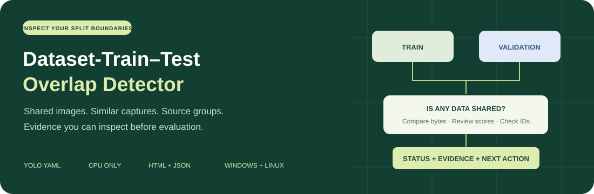

<p align="center">
  
</p>

# Dataset-Train–Test Overlap Detector

**Catch shared images and source groups before they undermine your model evaluation.**

[](https://github.com/asadozzaman/Dataset-Train-Test-Overlap-Detector/actions/workflows/tests.yml)
[](https://github.com/asadozzaman/Dataset-Train-Test-Overlap-Detector/actions/workflows/pages.yml)


[](LICENSE)

[**Explore the live showcase →**](https://asadozzaman.github.io/Dataset-Train-Test-Overlap-Detector/)
 · [Quickstart](docs/QUICKSTART.md) · [Documentation](docs/README.md) · [Report guide](docs/REPORTS.md)

The public showcase hosts authentic dataset previews and benchmark comparisons,
with verified measurements, original-source links and downloadable reports.
Image redistribution terms and complete attribution remain under review; see
[research evidence](RESEARCH_EVIDENCE.md) and [build/deployment instructions](docs/DEPLOYMENT.md).

Audit Train, Validation, and Test image splits in a local YOLO dataset. Detect identical
image files regardless of their names, review visually similar candidates, and check
shared source-video or recording-session IDs when provenance records are available.
Get a standalone visual HTML report and structured JSON. The auditor never edits your dataset.

The Python package and CLI are called **`videosplitguard`**. Current version: **0.2.0a4 (alpha)**.
Installation is from this repository; there is no published PyPI release yet.

## What it checks

| Check | How it works | Interpretation |
|---|---|---|
| Exact image overlap | Shared resolved paths and streaming SHA-256 hashes | Confirmed byte/path overlap, including renamed copies |
| Source-video overlap | Groups IDs in an optional provenance CSV | Confirmed metadata assertions when reviewed source references are supplied |
| Recording-session overlap | Groups session IDs across splits | Same evidence rules as source videos |
| Similar images, optional | dHash candidates followed by SSIM | Measured appearance scores; candidates require review |
| Split recommendations, optional | Groups exact images and reviewed source IDs | A proposed CSV; source files stay untouched |

**Missing provenance stays NOT VERIFIED.** An exact-overlap PASS does not establish
that videos or recording sessions are independent.

## Run your first audit

You need Python 3.10+ and Git:

```bash
git clone https://github.com/asadozzaman/Dataset-Train-Test-Overlap-Detector.git
cd Dataset-Train-Test-Overlap-Detector
python -m venv .venv
```

Use `python3` on Linux if needed. **Windows PowerShell:**

```powershell
.\.venv\Scripts\python.exe -m pip install ".[similarity]"
.\.venv\Scripts\videosplitguard.exe audit "path\to\data.yaml" --near-duplicates --output "reports\first-audit"
```

**Linux:**

```bash
.venv/bin/python -m pip install '.[similarity]'
.venv/bin/videosplitguard audit path/to/data.yaml --near-duplicates --output reports/first-audit
```

Replace the configuration path with your own. Open `reports/first-audit/report.html`;
`report.json` contains the same analysis in a machine-readable form. Choose a new
output directory for every run. For exact and provenance checks alone, install `.`
and omit `--near-duplicates`. Have source records? Add `--provenance path/to/sources.csv`.

See the [complete quickstart](docs/QUICKSTART.md) for official-data examples and troubleshooting.

## Understand the result

| Status | Meaning | Next action |
|---|---|---|
| **FAIL** | Confirmed byte/path overlap or a reviewed source-ID conflict crosses splits | Inspect members and keep related data in one split unless reuse is intentional |
| **NOT VERIFIED** | Source records are missing/unreviewed, candidates need inspection, or a check hit a limit | Review candidates and supply reliable provenance |
| **PASS** | Completed checks found no conflict and every membership has reviewed video/session records | Retain the manifest and rerun after changes |

An audit exit code is separate from its status: by default **1** means confirmed
overlap, **0** means no confirmed overlap, and **2** means an input or operational
error. A NOT VERIFIED report can return 0. `--fail-on any` also fails for candidate
findings; `--fail-on none` still returns 2 for input errors.

## Inspect real evidence

The [interactive showcase](https://asadozzaman.github.io/Dataset-Train-Test-Overlap-Detector/)
connects original image references, measured findings, source links, and complete reports.

| Verification example | Observed result | Evidence boundary |
|---|---|---|
| Official COCO128 configuration | **128 exact-overlap groups** | Intentional reuse of the same 128 images for Train and Validation |
| Official COCO8 configuration | **0 exact-overlap groups** | Separate 4/4 image baseline; source histories remain unverified |
| UBC compression benchmark files | **97.46%, 92.61%, 86.11% SSIM** | Original OpenCV-hosted files; illustrative split assignments |
| Leuven lighting benchmark files | **72.01% SSIM**, 100% dHash agreement | Demonstrates why two appearance metrics can disagree |

SSIM percentages measure appearance after documented normalization. They are
**not leakage percentages, probabilities, or proof of shared recording history**.
Near-duplicate findings stay NOT VERIFIED. The renamed-image example is explicitly
labeled as a controlled capability check.

Reproduce the public-data checks:

```powershell
.\.venv\Scripts\python.exe scripts\verify_public_datasets.py --download --output reports\public-run
```

Only the explicitly invoked verification/download scripts fetch data. The audit
command does not download images or execute YAML download directives. Dataset files
and generated reports are excluded from Git. Read the [verification records](docs/VERIFICATION.md)
and [dataset credits and terms](THIRD_PARTY_NOTICES.md).

## Input and output at a glance

```yaml
# data.yaml, next to images/
train: images/train
val: images/val
test: images/test  # Optional
```

Directories, individual images, text manifests, and lists of those are supported.
At least two configured splits must contain images. See [path resolution rules](docs/INPUTS.md).

Optional provenance CSV — **illustrative rows, not authentic recording histories**:

```csv
path,video_id,session_id,evidence,source_ref
images/train/frame_001.jpg,session01/video_a,session01,verified,reviewed-export-log
images/val/frame_080.jpg,session01/video_a,session01,verified,reviewed-export-log
```

`verified` means you reviewed the cited record. The software cannot independently
authenticate it. Read the [provenance guide](docs/INPUTS.md#source-provenance).

```text
reports/first-audit/
├── report.html             # Offline image evidence, statuses and next steps
├── report.json             # Structured findings, coverage, metrics and limits
└── suggested_splits.csv    # Only with --recommend-splits
```

## Design and limits

One Python package, one synchronous CPU process, and local files. PyYAML handles
configuration; Pillow handles previews; the optional similarity extra adds NumPy.
Windows and Linux are supported. Auditing requires no GPU, model weights, training,
account, database, or cloud service. The hosted showcase is a static evidence viewer;
run the CLI locally to audit new datasets.

- Exact matching compares **file bytes**, rather than decoded pixel equality.
- Similarity is bounded to **2,000 unique images**, **16 million pixels per image**,
  and **500 SSIM-scored candidate pairs**. At most 1,999,000 inexpensive path pairs
  are considered. Hitting a limit is disclosed.
- Grayscale resizing can miss or misread color changes, crops, rotation, alignment,
  and low-detail images. There is no semantic scene-understanding model.
- Embedded previews are bounded; all member references remain inspectable.
- Split proposals need review and do not assess label/class balance.
- Label quality, image-integrity validation, and authentic recording-history field
  validation are outside the current scope.

See [architecture](docs/ARCHITECTURE.md), [CLI reference](docs/CLI.md), and
[report contract](docs/CONTRACTS.md) for exact behavior.

## Develop and contribute

Inside your virtual environment:

```bash
python -m pip install -e '.[dev,similarity]'
python -m ruff check .
python -m ruff format --check .
python -m pytest -q
python -m build
```

The Python suite contains **68 tests**; **13 showcase interaction checks** use Node
and jsdom. An optional Chrome suite checks five responsive widths, keyboard behavior,
project-path serving and automated accessibility. Hosted CI covers Windows/Ubuntu
and Python 3.10/3.13. These counts describe
automated coverage, not a guarantee of finding every leak.

Start with [CONTRIBUTING.md](CONTRIBUTING.md). Bug reports should include a minimal
configuration and sanitized findings. Keep private images and source logs private.

## Documentation

| I want to… | Read |
|---|---|
| Run an audit | [Quickstart](docs/QUICKSTART.md) |
| Configure image paths and source records | [Inputs and provenance](docs/INPUTS.md) |
| Understand options and exit codes | [CLI reference](docs/CLI.md) |
| Interpret findings and scores | [Report guide](docs/REPORTS.md) |
| Integrate JSON output | [Report contract](docs/CONTRACTS.md) |
| Understand implementation | [Architecture](docs/ARCHITECTURE.md) |
| Review validation and remaining work | [Verification](docs/VERIFICATION.md) · [Checklist](docs/IMPLEMENTATION_PLAN.md) |
| Build or publish the showcase | [Showcase](showcase/README.md) · [Deployment](docs/DEPLOYMENT.md) |

## License and acknowledgments

Project code is [MIT licensed](LICENSE). Dataset images retain their own terms;
the MIT license does not relicense COCO, Flickr, or benchmark images.
See [third-party notices](THIRD_PARTY_NOTICES.md) for sources and credits.
Public workflows from FiftyOne, Datumaro, and related tools informed the scope;
the implementation and presentation are original. [Research notes](docs/RESEARCH.md).
